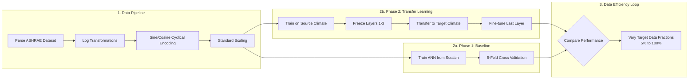
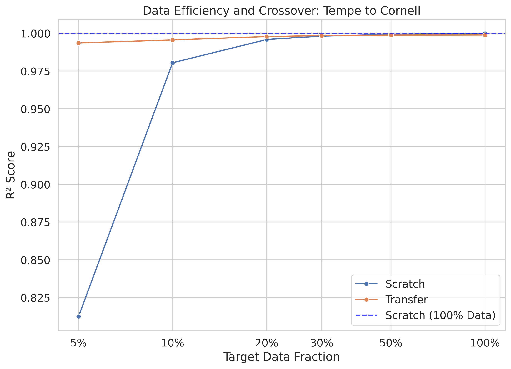
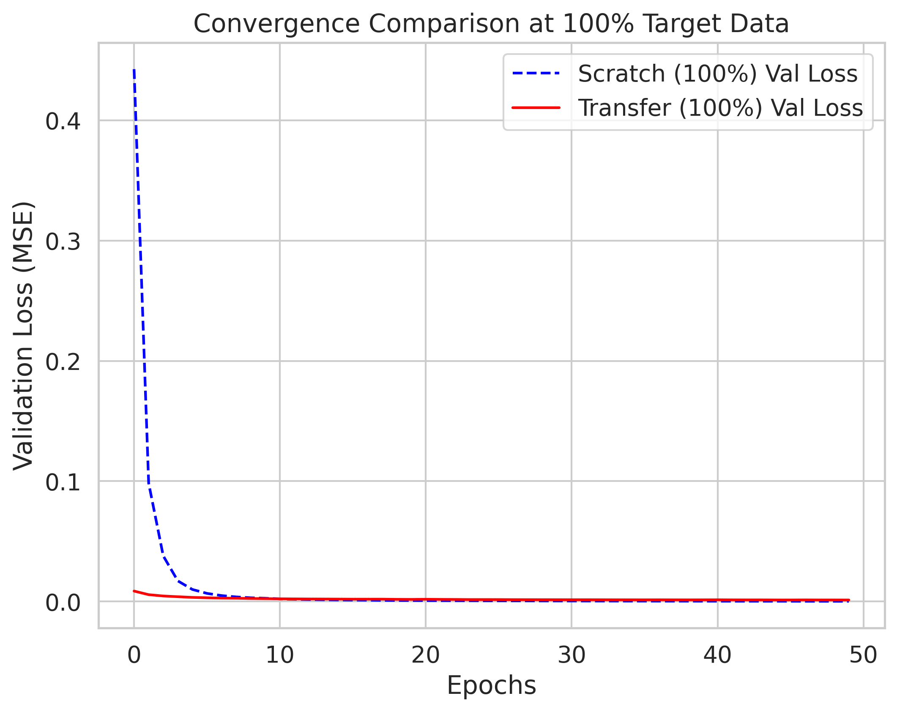

# PPT Content (Review 2 Presentation)

## Slide 1: Title Slide
*   **Title:** Climate-Aware Transfer Learning for Net Zero Energy Buildings (NZEB)
*   **Sub-title:** Summer Internship (CSXXXX) - Review 2
*   *(Fill in your Team Members and Guide Details)*

## Slide 2: Title and Problem Definition
*   **Problem:** Newly built NZEBs suffer from a "cold start" data scarcity problem. They lack historical data, making it impossible for standard machine learning models to accurately predict and optimize their energy consumption.
*   **Limitations of existing systems:** Current predictive models require years of building-specific data to function accurately. They fail when applied to brand new buildings. Traditional physics-based simulations (like EnergyPlus) are highly accurate but computationally expensive and slow.
*   **Novelty:** Proposing a Transfer Learning (TL) approach to transfer energy consumption patterns from data-rich climates (Source) to data-scarce new buildings in different climates (Target), completely bypassing the data collection waiting period.

## Slide 3: Aim and Objectives
*   **Aim:** To develop and validate a Transfer Learning framework that effectively predicts building energy consumption in data-scarce environments by leveraging Artificial Neural Networks (ANNs) pre-trained on diverse ASHRAE climate zones.
*   **Objectives:**
    *   To process and encode temporal energy data across three distinct climate zones (Tempe, Berkeley, Cornell).
    *   To design a baseline deep feed-forward Artificial Neural Network (ANN) from scratch.
    *   To implement a Transfer Learning pipeline by freezing the initial layers of a pre-trained model and fine-tuning the final layer on target data.
    *   To identify the exact "crossover point" (data fraction percentage) where Transfer Learning loses its advantage over training from scratch.

## Slide 4: Introduction & Scope
*   **Basic Introduction:** As the world moves towards Net Zero Energy Buildings to combat climate change, accurate energy prediction is critical for grid stability and building optimization.
*   **Scope and Context:** The project focuses on utilizing the ASHRAE Great Energy Predictor III dataset to predict electricity consumption (Meter 0) across highly diverse climate zones (Zone 2B, 3C, and 6A).
*   **Key Challenges:** Handling massive datasets (800k+ rows per site), managing skewed data, and ensuring models do not overfit when simulating extreme data scarcity (e.g., training on only 5% of data).

## Slide 5: Literature Survey
*   **Summary:** Existing literature heavily focuses on using AI to replace slow, physics-based building simulations. Optimization papers use AI surrogate models to evaluate thousands of designs instantly (e.g., using Genetic Algorithms). Prediction papers use LSTMs for forecasting based on historical data.
*   **Research Gap:** While AI is proven to reduce computational cost compared to traditional simulations, existing literature assumes ample historical data is available. There is a critical gap in predictive modeling for *new* buildings immediately post-construction.
*   **Justification:** Our proposed work bridges this gap by introducing Transfer Learning to eliminate the dependency on long-term historical data generation.

## Slide 6: Requirement Specification
*   **Software Requirements:**
    *   **Languages & Libraries:** Python 3.x, TensorFlow, Keras, Pandas, Scikit-Learn, Matplotlib/Seaborn (for visualization).
    *   **Environment:** Kaggle Notebooks (for headless cloud execution).
*   **Hardware Requirements:**
    *   **Compute:** Kaggle Cloud GPUs (Dual NVIDIA T4 GPUs) for parallel processing and overcoming local memory constraints.
    *   **Storage:** Sufficient cloud storage for handling the 800k+ rows ASHRAE dataset.

## Slide 7: Proposed Methodology (System Architecture)

*   **Data Pipeline:** Parsing ASHRAE dataset -> Log Transformations for skewed data -> Sine/Cosine cyclical encoding for temporal features -> Standard Scaling.
*   **Phase 1 (Baseline):** Train a 4-hidden-layer ANN `[256, 128, 64, 32]` from scratch on the target climate (5-Fold Cross Validation).
*   **Phase 2 (Transfer):** Train ANN on a source climate (e.g., Tempe). Freeze layers 1 to 3. Transfer to the target climate (e.g., Cornell) and fine-tune only the last layer.
*   **Phase 3 (Data Efficiency Loop):** Restrict target training data to fractions (5%, 10%, 20%, 30%, 50%, 100%) and compare Scratch vs. Transfer performance.

## Slide 8: Implementation Work Completed Since Review-01
*   **Module 1: Cloud Orchestration:** Successfully migrated the entire training pipeline to Kaggle Cloud GPUs, optimizing batch sizes (256) to handle 800k+ rows per site without out-of-memory errors.
*   **Module 2: The Data Efficiency Loop:** Implemented the core experiment suggested by the mentor—iteratively training models on restricted data fractions to simulate the lifespan of a new building.
*   **Module 3: Statistical Validation:** Ran all Transfer and Scratch pipelines across 3 different random seeds (42, 123, 456) to ensure the findings were statistically significant and not flukes.

## Slide 9: Experimental Results / Output
*   
*   **Key Result:** At extreme scarcity (5% data), Transfer Learning achieved an R² of 0.9936 compared to Scratch's 0.8124 (a massive +0.1812 boost).
*   
*   **Key Result:** The crossover point was successfully identified precisely at 30% data availability, where the Scratch model finally catches up to the frozen Transfer model.

## Slide 10: Conclusion
*   **Solving the Cold Start Problem:** The project successfully proves that Transfer Learning is a highly effective, computationally efficient solution for newly constructed NZEBs that lack historical operational data.
*   **Data Efficiency Breakthrough:** By utilizing pre-trained weights from data-rich climates, new buildings can achieve highly accurate energy predictions (0.99 R²) with only a tiny fraction (5%) of required historical data, bypassing years of data collection.
*   **Resource Optimization:** The frozen-layer architecture significantly reduces training time and computational overhead compared to training massive models from scratch.
*   **Real-world Applicability:** Identifying the exact crossover point (30% data availability) provides a concrete operational threshold for facility managers to know exactly when to switch from a transferred model to a custom scratch model.

## Slide 11: Future Work
*   **Sequential & Temporal Modeling:** Extend the Transfer Learning architecture to utilize Recurrent Neural Networks (LSTMs or GRUs) and Transformers to better capture longer-term sequential dependencies and complex weather patterns.
*   **Cross-Domain Transferability:** Test model transferability across entirely different building types (e.g., transferring knowledge from a commercial office building to a residential complex or educational facility) rather than just across different climate zones.
*   **Real-Time API Integration:** Deploy the best-performing models via a live REST API to ingest real-time IoT sensor data from NZEBs for continuous, on-the-fly energy consumption optimization.
*   **Multi-Task Learning:** Expand the framework to predict secondary metrics concurrently with electricity, such as chilled water consumption, steam usage, and peak-hour HVAC load requirements.

## Slide 12: References
*   *Evaluating ChatNetZero, an LLM-Chatbot to Demystify Climate Pledge* - [Link](https://aclanthology.org/2024.climatenlp-1.6/)
*   *Multi-Agent RAG Chatbot Architecture for Decision Support in Net-Zero Emission Energy Systems* - [Link](https://ieeexplore.ieee.org/document/10540920)
*   *EnergAI: A Large Language Model-Driven Generative Design Method for Early-Stage Building Energy Optimization* - [Link](https://www.mdpi.com/1996-1073/18/22/5921)
*   *Artificial Intelligence and Digital Tools for Assisting Low-Carbon Architectural Design: Merging the Use of Machine Learning, Large Language Models, and Building Information Modeling for Life Cycle Assessment Tool Development* - [Link](https://www.mdpi.com/1996-1073/17/12/2997)
*   *Artificial Intelligence in Net-Zero Carbon Emissions for Sustainable Building Projects: A Systematic Literature and Science Mapping Review* - [Link](https://www.mdpi.com/2075-5309/14/9/2752)
