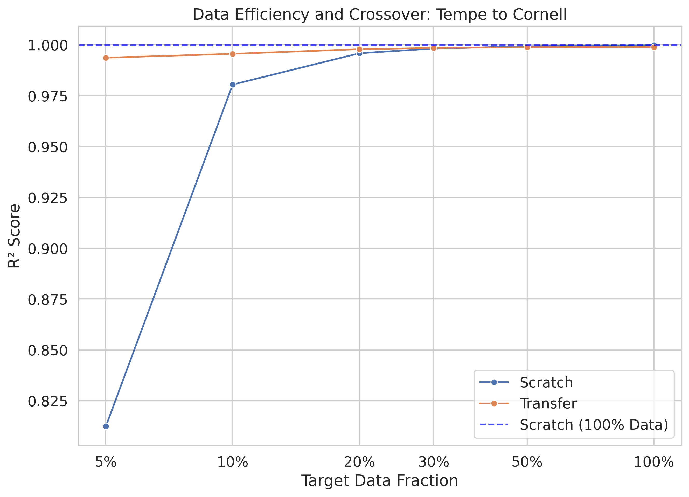
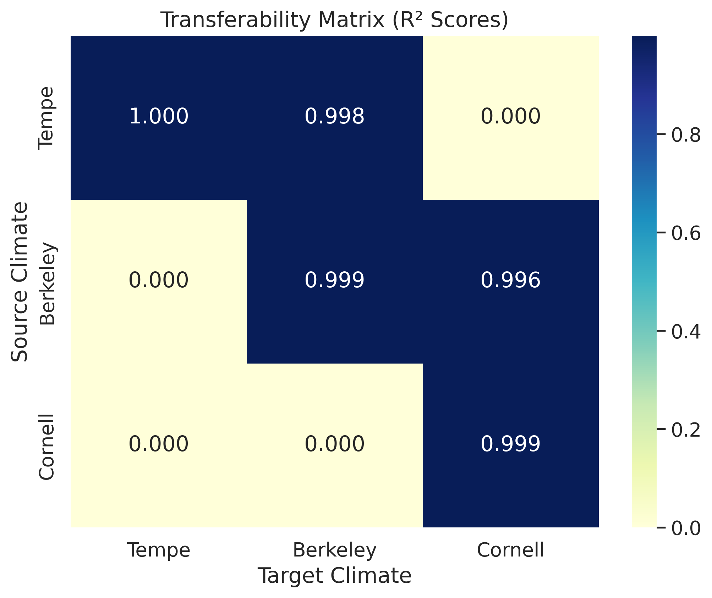

# Transfer Learning for Cross-Climate Building Energy Prediction

**Investigating Data Efficiency and Generalization Across Climate Zones**

## Overview
This repository contains the implementation for the research paper exploring cross-climate building energy prediction. The core objective is to investigate whether transfer learning can significantly reduce the amount of target-climate training data required when predicting building energy consumption across different climate zones. 

While existing Net-Zero Energy Building (NZEB) models are often "climate-locked" (performing poorly outside their original training climate), this project leverages **Climate-Aware Transfer Learning** to adapt models across vastly different climates (e.g., from the hot-arid climate of Tempe, AZ to the cold-humid environment of Ithaca, NY) using a fraction of the traditional data requirements.

## Key Results & Findings

### The Data Efficiency Crossover Point
Our primary experiment restricted target training data to 5%, 10%, 20%, 30%, 50%, and 100% fractions to simulate data scarcity.

| Target Data Fraction | Scratch Model (Mean R²) | Transfer Model (Mean R²) | Performance Gap (TL - Scratch) |
| :--- | :--- | :--- | :--- |
| **5% (Extreme Scarcity)** | 0.8124 | 0.9936 | **+0.1812** |
| **10%** | 0.9798 | 0.9955 | **+0.0157** |
| **20%** | 0.9958 | 0.9978 | **+0.0020** |
| **30%** | 0.9981 | 0.9984 | **+0.0003** (Crossover Point) |
| **50%** | 0.9992 | 0.9987 | -0.0005 |
| **100% (Full Data)** | 0.9998 | 0.9989 | -0.0009 |

**Key Finding:** Transfer Learning completely dominates in data-scarce environments (5% to 20%), essentially solving the "cold start" problem for newly constructed buildings. However, as data availability reaches ~30%, a **crossover point** occurs where training a model from scratch overtakes the transfer model due to the transfer model's frozen generalized layers.

## Dataset & Selected Domains
We utilize the **ASHRAE Great Energy Predictor III** benchmark dataset, focusing on real-world operational electricity meter data.

| Site ID | Location (De-anonymized) | Climate Zone | Climate Type |
| :---: | :--- | :---: | :--- |
| **2** | Arizona State University (Tempe, AZ) | **2B** | Hot-Arid |
| **4** | UC Berkeley (Berkeley, CA) | **3C** | Marine |
| **15** | Cornell University (Ithaca, NY) | **6A** | Cold-Humid |

## Evaluation Metrics
The models are rigorously evaluated using standard regression metrics:
- **$R^2$ Score**: Proportion of variance explained (Primary metric).
- **RMSE (Root Mean Squared Error)**: Measures the average magnitude of absolute error.
- **MAPE (Mean Absolute Percentage Error)**: Measures the relative percentage error.

## Experimental Methodology
The workflow is structured into 5 discrete experimental phases:
1. **Phase 1 (Data Integration):** Load and merge ASHRAE datasets, filtering exclusively for electricity meters across our target climates.
2. **Phase 2 (Feature Engineering):** Extract temporal cyclic features (Sine/Cosine transformations), apply logarithmic scaling to energy targets (`np.log1p`), and standardize numerical variables.
3. **Phase 3 (Baseline/Scratch Models):** Train deep ANNs `[256 -> 128 -> 64 -> 32 -> 1]` entirely from scratch on each site using 5-Fold Cross-Validation.
4. **Phase 4 (Transfer Learning Matrix):** Pre-train on a source climate, freeze the first 3 layers, and fine-tune on target climates (e.g., Berkeley to Cornell).
5. **Phase 5 (Data Efficiency Experiment):** Escalate target data subsets (5% to 100%) and compare Scratch vs. Transfer Learning performance across 3 random seeds (42, 123, 456) to ensure statistical validity.

## Project Structure
- `notebooks/NZEB_Climate_Transfer.ipynb` - The primary experimentation notebook (fully Kaggle compatible).
- `src/` - Modularized Python codebase containing data loaders, feature engineering pipelines, model architectures, and training scripts.
- `results_v4/` - Contains the final output CSVs and high-resolution figures proving the data efficiency hypothesis.

## Getting Started (Kaggle)
This codebase is strictly optimized for Kaggle environments to bypass local hardware restrictions. 
Training 100+ deep learning models requires massive parallel compute. The pipeline is optimized to run completely headlessly on **Kaggle Cloud GPUs (T4 x2)**.

1. Compress the `src/` folder and `merged_ashrae.csv` into a `.zip` archive.
2. In your Kaggle Notebook, click **Add Data** -> **Upload Data** -> **New Dataset**.
3. Upload the `.zip` archive. Kaggle will automatically mount it to `/kaggle/input/`.
4. Import the provided `NZEB_Climate_Transfer.ipynb` notebook.
5. Click **Save Version -> Save & Run All (Commit)**. The script will dynamically execute the entire experiment matrix in the background and output the results and figures into the Kaggle output directory.

## Future Work & Next Steps

Building upon the current findings regarding the "cold start" problem and the data efficiency crossover point, the following research directions are proposed:

1. **Dynamic Fine-Tuning & Layer Unfreezing:** Investigate progressive unfreezing or dynamic learning rates during the fine-tuning phase to potentially eliminate the crossover point observed at 30% target data availability.
2. **Advanced Time-Series Architectures:** Upgrade the core MLP architecture to sequential models like LSTMs or Time-Series Transformers to inherently capture chronological dependencies (e.g., prolonged heatwaves).
3. **Domain Adversarial Neural Networks (DANNs):** Implement domain adaptation techniques to align the feature distributions of source and target climates, forcing the model to learn truly "climate-agnostic" physics features.
4. **Zero-Shot Climate Transfer:** Push the boundaries of data efficiency by attempting Zero-Shot Transfer Learning—predicting energy usage in a brand new climate with 0% target training data.
5. **Practical NZEB Control Integration:** Transition from passive prediction to active simulation by integrating the Transfer Learning model with building physics simulators (e.g., EnergyPlus) for real-time HVAC control optimization.