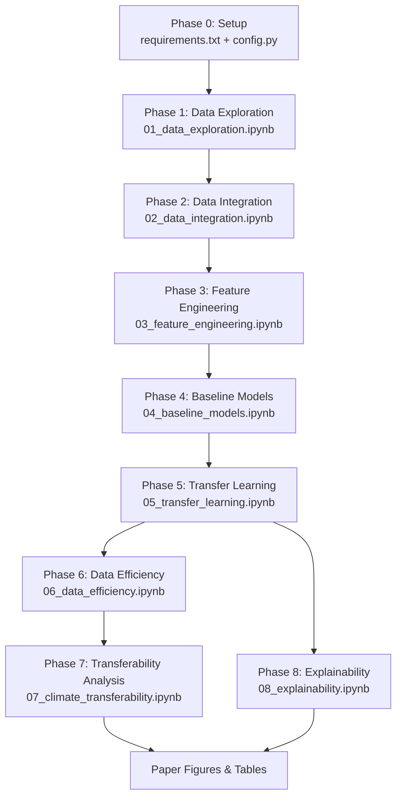

# Quantifying Climate-Aware Transferability in Building Energy Prediction — Implementation Plan

## Background & Goal

This plan implements the methodology from [Final approach.md](file:///d:/Desktop/Shree/NZEB ANN/Implementation/Final approach.md) for the research paper **"Quantifying Climate-Aware Transferability in Building Energy Prediction"**.

**Research Question:** *Can transfer learning effectiveness in building energy prediction be quantitatively explained by the climatic dissimilarity between source and target regions?*

**Hypothesis:** *Transfer learning effectiveness decreases as climatic dissimilarity between source and target domains increases.*

The project uses the **ASHRAE Great Energy Predictor III** dataset with three de-anonymised sites:

| Site ID | Location | ASHRAE Climate Zone | Role |
|---------|----------|---------------------|------|
| 2 | Arizona State University, Tempe, AZ | 2B (Hot-Arid) | Source |
| 4 | UC Berkeley, Berkeley, CA | 3C (Marine) | Source / Target |
| 15 | Cornell University, Ithaca, NY | 6A (Cold-Humid) | Target |

---

## User Review Required

> [!IMPORTANT]
> **Dataset availability** — The plan assumes you already have `train.csv`, `weather_train.csv`, and `building_metadata.csv` from the ASHRAE competition downloaded locally. Confirm these are available before we begin.

> [!IMPORTANT]
> **Execution environment** — The methodology doc mentions Google Colab. Should we build the notebooks as `.ipynb` files for Colab, or as standalone `.py` scripts that can run locally / on Colab? This affects how we structure the output.

> [!WARNING]
> **Compute budget** — Training 18+ ANN models (3 baselines × 6 data fractions + 3 transfer scenarios × 6 data fractions) with early stopping and potential SHAP explainability may take significant GPU time. Confirm if you have Colab Pro / GPU access.

## Open Questions

1. **Meter type** — The doc filters to `meter == 0` (electricity). Should we also run experiments on other meter types (chilled water, steam, hot water), or keep it electricity-only for the paper?
2. **Climate distance metric** — The doc mentions "climate distance" qualitatively (e.g., 1, 3, 4). Do you want to compute a formal numerical distance (e.g., Euclidean distance of mean weather features between sites, or use ASHRAE zone difference), or keep the ordinal ranking?
3. **Cross-validation** — The doc imports `KFold` but doesn't explicitly use it. Should we implement k-fold cross-validation for robustness, or stick with a single train/val/test split per site?
4. **Reverse transfers** — Should we also test Cornell → Tempe and Cornell → Berkeley (cold-to-hot) to make the transferability matrix bidirectional?

---

## Proposed Changes

The entire codebase will be built inside the workspace directory. Each phase from the methodology becomes a modular, self-contained script/notebook.

### Project Structure

```
d:\Desktop\Shree\NZEB ANN\Implementation\
├── data/                          # Raw CSV files (user-provided)
│   ├── train.csv
│   ├── weather_train.csv
│   └── building_metadata.csv
├── notebooks/                     # Jupyter notebooks (one per phase)
│   ├── 01_data_exploration.ipynb
│   ├── 02_data_integration.ipynb
│   ├── 03_feature_engineering.ipynb
│   ├── 04_baseline_models.ipynb
│   ├── 05_transfer_learning.ipynb
│   ├── 06_data_efficiency.ipynb
│   ├── 07_climate_transferability.ipynb
│   └── 08_explainability.ipynb
├── src/                           # Reusable Python modules
│   ├── __init__.py
│   ├── config.py                  # All hyperparams, site mappings, paths
│   ├── data_loader.py             # Load, merge, filter datasets
│   ├── feature_engineering.py     # Temporal features, encoding, scaling
│   ├── model.py                   # ANN builder, compile, train functions
│   ├── transfer.py                # Transfer learning utilities
│   ├── metrics.py                 # R², MAPE, RMSE, timing
│   └── visualization.py          # All paper-quality figures
├── models/                        # Saved .keras model weights
├── results/                       # CSV results tables, logs
├── figures/                       # Publication-quality plots
└── requirements.txt               # All dependencies
```

---

### Phase 0 — Environment & Configuration

#### [NEW] [requirements.txt](file:///d:/Desktop/Shree/NZEB ANN/Implementation/requirements.txt)
- Pin versions for reproducibility: `pandas`, `numpy`, `scikit-learn`, `tensorflow`, `matplotlib`, `seaborn`, `shap`, `jupyter`

#### [NEW] [config.py](file:///d:/Desktop/Shree/NZEB ANN/Implementation/src/config.py)
- Central configuration file containing:
  - Site-to-location mappings: `{2: "Tempe", 4: "Berkeley", 15: "Cornell"}`
  - Climate zone mappings: `{2: "2B", 4: "3C", 15: "6A"}`
  - Feature lists, hyperparameters (layers, learning rate, epochs, patience)
  - Data fraction percentages: `[0.05, 0.10, 0.20, 0.30, 0.50, 1.0]`
  - File paths, random seeds for reproducibility

---

### Phase 1 — Data Exploration (Methodology Phases 1–2)

#### [NEW] [01_data_exploration.ipynb](file:///d:/Desktop/Shree/NZEB ANN/Implementation/notebooks/01_data_exploration.ipynb)

**What it does:**
1. Load all three CSV files (`train.csv`, `weather_train.csv`, `building_metadata.csv`)
2. Run `head()`, `info()`, `shape`, `describe()`, `isnull().sum()` on each
3. Filter to electricity meters only (`meter == 0`)
4. Filter to selected sites (`site_id ∈ {2, 4, 15}`)
5. Generate exploratory visualizations:
   - Missing value heatmap per dataset
   - Distribution of meter readings per site (histogram + box plots)
   - Weather variable distributions per site (temperature, humidity, wind)
   - Building type distribution per site
   - Temporal patterns: hourly/monthly energy profiles per site

**Output:** Summary statistics table, exploratory plots, confirmation that sites have sufficient data

---

### Phase 2 — Data Integration (Methodology Phase 3)

#### [NEW] [data_loader.py](file:///d:/Desktop/Shree/NZEB ANN/Implementation/src/data_loader.py)

**What it does:**
- `load_raw_data(data_dir)` → loads all 3 CSVs
- `filter_and_merge(train, weather, building, sites, meter_type)` → performs the two-step merge:
  1. `train ⟕ building` on `building_id`
  2. `result ⟕ weather` on `[site_id, timestamp]`
- `split_by_site(df)` → returns `{site_id: DataFrame}` dictionary
- Validates merge completeness (checks for NaN explosions, row count changes)

#### [NEW] [02_data_integration.ipynb](file:///d:/Desktop/Shree/NZEB ANN/Implementation/notebooks/02_data_integration.ipynb)
- Calls `data_loader` functions, validates merged output
- Prints `df.shape`, `df.columns`, `df.describe()` post-merge
- Checks for duplicate rows and timestamp alignment issues

---

### Phase 3 — Feature Engineering (Methodology Phase 4)

#### [NEW] [feature_engineering.py](file:///d:/Desktop/Shree/NZEB ANN/Implementation/src/feature_engineering.py)

**What it does:**
- `add_temporal_features(df)`:
  - Converts `timestamp` to datetime
  - Extracts: `hour`, `month`, `weekday`, `dayofyear`
  - Optionally adds cyclical encoding (sin/cos transforms for hour, month)
- `transform_target(df)`:
  - Applies `np.log1p()` to `meter_reading`
- `handle_missing(df)`:
  - Fills NaN with column medians (numeric only)
- `encode_categoricals(df)`:
  - One-hot encodes `primary_use` using `pd.get_dummies()`
- `prepare_features(df)`:
  - Drops `meter_reading`, `timestamp`, `building_id`, `site_id`, `meter`
  - Returns `(X, y, feature_names)`
- `scale_features(X_train, X_test)`:
  - Fits `StandardScaler` on train, transforms both
  - Returns `(X_train_scaled, X_test_scaled, scaler)`

#### [NEW] [03_feature_engineering.ipynb](file:///d:/Desktop/Shree/NZEB ANN/Implementation/notebooks/03_feature_engineering.ipynb)
- Applies all feature engineering steps
- Validates feature distributions post-transformation
- Saves processed per-site datasets to `data/processed/`

> [!TIP]
> The log transform of `meter_reading` is critical — energy data is heavily right-skewed. All metrics should be computed in both log-space and original-space (using `np.expm1()` to invert).

---

### Phase 4 — Baseline Models (Methodology Phases 6–8)

#### [NEW] [model.py](file:///d:/Desktop/Shree/NZEB ANN/Implementation/src/model.py)

**What it does:**
- `build_ann(input_dim, layers=[256, 128, 64, 32], activation='relu')`:
  - Builds the 5-layer Sequential ANN as specified
  - Returns uncompiled model
- `compile_model(model, learning_rate=1e-5)`:
  - Compiles with Adam optimizer and MSE loss
- `train_model(model, X_train, y_train, epochs=100, patience=10, validation_split=0.2)`:
  - Trains with EarlyStopping callback
  - Records wall-clock training time
  - Returns `(model, history, training_time)`

#### [NEW] [metrics.py](file:///d:/Desktop/Shree/NZEB ANN/Implementation/src/metrics.py)

**What it does:**
- `evaluate(y_true, y_pred)` → returns dict with `R²`, `MAPE`, `RMSE`
- `evaluate_original_scale(y_true_log, y_pred_log)` → applies `np.expm1()` first, then computes metrics
- `results_to_dataframe(results_list)` → collects all experiment results into a tidy DataFrame

#### [NEW] [04_baseline_models.ipynb](file:///d:/Desktop/Shree/NZEB ANN/Implementation/notebooks/04_baseline_models.ipynb)

**What it does:**
1. For **each site** (Tempe, Berkeley, Cornell):
   - Split into 80/20 train/test
   - Build and train ANN from scratch
   - Evaluate on held-out test set
   - Record: R², MAPE, RMSE, training time, epochs to convergence
2. Save trained models:
   - `models/tempe_baseline.keras`
   - `models/berkeley_baseline.keras`
   - `models/cornell_baseline.keras`
3. Generate training loss curves (train vs. validation loss per epoch)

**Output:** Baseline performance table:

| Model | Site | R² | MAPE | RMSE | Time (s) | Epochs |
|-------|------|----|------|------|----------|--------|
| Scratch | Tempe | — | — | — | — | — |
| Scratch | Berkeley | — | — | — | — | — |
| Scratch | Cornell | — | — | — | — | — |

---

### Phase 5 — Transfer Learning (Methodology Phase 9)

#### [NEW] [transfer.py](file:///d:/Desktop/Shree/NZEB ANN/Implementation/src/transfer.py)

**What it does:**
- `load_source_model(path)` → loads a saved `.keras` model
- `freeze_layers(model, n_freeze=3)`:
  - Freezes the first `n_freeze` layers (trainable = False)
  - Returns modified model
- `recompile_for_transfer(model, learning_rate=1e-4)`:
  - Recompiles with a potentially different (higher) learning rate for fine-tuning
- `transfer_and_train(source_path, X_target, y_target, n_freeze=3, ...)`:
  - Full pipeline: load → freeze → recompile → train on target data
  - Returns `(model, history, training_time)`

#### [NEW] [05_transfer_learning.ipynb](file:///d:/Desktop/Shree/NZEB ANN/Implementation/notebooks/05_transfer_learning.ipynb)

**What it does:**
1. Load source models (Tempe, Berkeley)
2. For each transfer scenario:
   - **Tempe → Cornell** (climate distance: large, 2B → 6A)
   - **Berkeley → Cornell** (climate distance: medium, 3C → 6A)
   - **Tempe → Berkeley** (climate distance: small, 2B → 3C)
3. Freeze first 3 layers, fine-tune last 2 layers on target data
4. Evaluate and compare against baseline scratch models
5. Save transferred models

**Output:** Transfer learning results table comparing against baselines

---

### Phase 6 — Data Efficiency Experiment (Methodology Phase 10)

#### [NEW] [06_data_efficiency.ipynb](file:///d:/Desktop/Shree/NZEB ANN/Implementation/notebooks/06_data_efficiency.ipynb)

**What it does:**
1. For **each transfer scenario** (Tempe→Cornell, Berkeley→Cornell, Tempe→Berkeley):
2. For **each data fraction** `[5%, 10%, 20%, 30%, 50%, 100%]`:
   - Randomly sample that fraction of the target training data
   - Train a **transfer model** (load source → freeze → fine-tune on fraction)
   - Train a **scratch model** on the same fraction (for fair comparison)
   - Evaluate both on the **full** target test set
   - Record: R², MAPE, RMSE, training time, epochs
3. Repeat 3× with different random seeds for statistical robustness

**Output:** Results matrix (≈ 108 experiments total: 3 scenarios × 6 fractions × 2 methods × 3 seeds)

This is the **core experiment** that tests the hypothesis about data efficiency.

> [!IMPORTANT]
> This is the most compute-intensive phase. Consider running on GPU-enabled Colab runtime. Estimated time: 2–4 hours on a T4 GPU.

---

### Phase 7 — Climate Transferability Analysis (Methodology Phase 11)

#### [NEW] [07_climate_transferability.ipynb](file:///d:/Desktop/Shree/NZEB ANN/Implementation/notebooks/07_climate_transferability.ipynb)

**What it does:**
1. Compute **climate distance** between each site pair:
   - Option A: Ordinal ASHRAE zone difference (|2B − 3C| = 1, |2B − 6A| = 4, |3C − 6A| = 3)
   - Option B: Euclidean distance of mean weather features (temperature, humidity, wind speed)
2. Build the **transferability matrix**:

| Source | Target | Climate Distance | R² (Transfer) | R² (Scratch) | Transfer Gain |
|--------|--------|-----------------|---------------|--------------|---------------|
| 2B (Tempe) | 3C (Berkeley) | small | — | — | — |
| 2B (Tempe) | 6A (Cornell) | large | — | — | — |
| 3C (Berkeley) | 6A (Cornell) | medium | — | — | — |

3. **Correlation analysis**: Plot transfer gain vs. climate distance
4. **Statistical test**: Compute Pearson/Spearman correlation coefficient to validate hypothesis

---

### Phase 8 — Explainability (Methodology Phase 12)

#### [NEW] [08_explainability.ipynb](file:///d:/Desktop/Shree/NZEB ANN/Implementation/notebooks/08_explainability.ipynb)

**What it does:**
1. Use **SHAP (SHapley Additive exPlanations)** on:
   - Source model (pre-transfer)
   - Transferred model (post-fine-tuning)
   - Scratch model (baseline)
2. Generate SHAP summary plots for each
3. Compare feature importance rankings before and after transfer
4. Answer: *Which learned features transfer across climates?*
   - Expect: temporal features (hour, month) transfer well
   - Expect: weather features may shift importance between climates

---

### Visualization & Paper Figures

#### [NEW] [visualization.py](file:///d:/Desktop/Shree/NZEB ANN/Implementation/src/visualization.py)

Generates all 5+ publication-quality figures referenced in the methodology:

| Figure | Description | Type |
|--------|-------------|------|
| Fig 1 | Dataset pipeline (train → merge → features) | Flowchart / diagram |
| Fig 2 | ANN architecture (Input → 256 → 128 → 64 → 32 → Output) | Architecture diagram |
| Fig 3 | Transfer learning pipeline (Source → Pretrain → Freeze → Fine-tune) | Flowchart |
| Fig 4 | **Climate distance vs. accuracy** (scatter + regression line) | Scatter plot |
| Fig 5 | **Target data % vs. R²** (line plot, Transfer vs. Scratch) | Line plot |
| Fig 6 | Training loss curves (convergence comparison) | Line plot |
| Fig 7 | SHAP feature importance (before/after transfer) | Bar / beeswarm |
| Fig 8 | Transferability heatmap matrix | Heatmap |

All figures saved as high-DPI PNGs and vector PDFs in `figures/`.

---

## Execution Order



---

## Verification Plan

### Automated Tests
- **Sanity checks in each notebook:**
  - Post-merge row counts match expectations (no Cartesian product explosion)
  - No NaN values in final feature matrices
  - Model R² on training data > 0.5 (basic learning check)
  - Log-transformed predictions invert correctly (`np.expm1(np.log1p(x)) ≈ x`)
- **Reproducibility:** Fixed random seeds (`np.random.seed(42)`, `tf.random.set_seed(42)`) across all experiments

### Manual Verification
- After Phase 1: Review exploratory plots to confirm sites have distinct climate profiles
- After Phase 4: Verify baseline R² values are reasonable (expect 0.6–0.9 range for building energy)
- After Phase 6: Confirm transfer models outperform scratch models at low data fractions (the core hypothesis)
- After Phase 7: Check that the climate distance vs. transfer gain relationship is visible in the scatter plot
- Final: Review all figures for publication quality (font sizes, labels, legends, color consistency)
