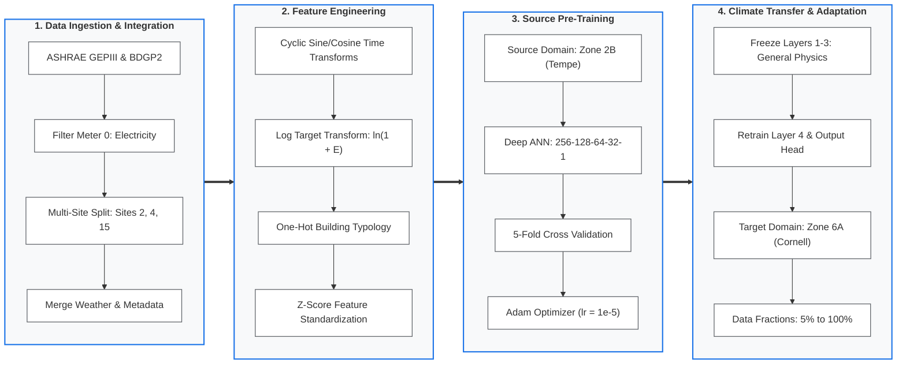
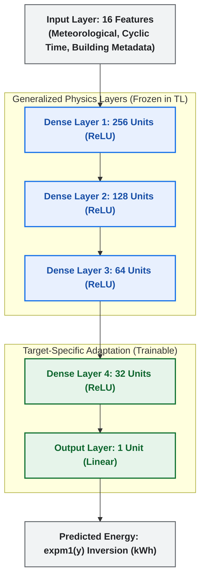

# System Architecture & Neural Network Topology (Mermaid Diagrams)

This document contains the official Mermaid diagram definitions used for Figure 1 and Figure 2 in the research paper:
*"Transfer Learning for Cross-Climate Building Energy Prediction: Investigating Data Efficiency and Generalization Across Climate Zones"*

---

## 1. System Pipeline Architecture (Figure 1)

---

## 2. Artificial Neural Network Architecture & Parameter Freezing (Figure 2)

