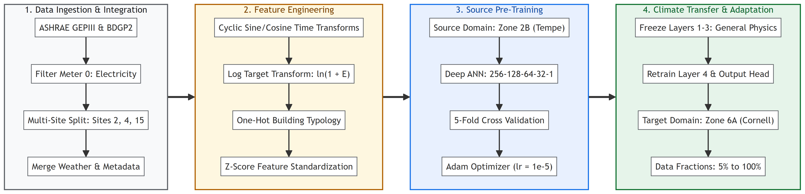
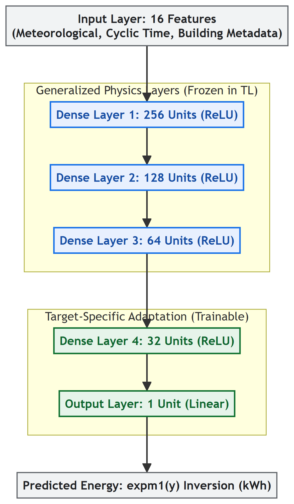

# Transfer Learning for Cross-Climate Building Energy Prediction

**IEEE Conference Paper Draft**

## Authors
1. **Shree Santosh Yadav** (USN: `1RUA24CSE0436`, `shreesantoshyadavbtech24@rvu.edu.in`)
2. **Samyak Jain** (USN: `1RUA24CSE0406`, `samyakjainbtech24@rvu.edu.in`)
3. **Meda Vijaya Snehan** (USN: `1RUA24CSE0232`, `mvijayasnehanbtech24@rvu.edu.in`)

*School of Computer Science and Engineering, RV University, Bengaluru, India*

---

## Paper Editions
- **6-Page Strict IEEE Conference Edition** (Recommended for submissions with a 6-page limit):
  - `paper_6page.tex` — Optimized LaTeX source with calibrated float margins, consolidated equations, and balanced two-column bibliography.
  - `paper_6page.pdf` — Pre-compiled camera-ready 6-page PDF with zero spillover.
- **7-Page Full Edition** (Original extended manuscript):
  - `paper.tex` — Unrestricted full LaTeX source.
  - `paper.pdf` — Pre-compiled 7-page PDF.

---

## Directory Contents
- `paper_6page.tex` & `paper_6page.pdf` — 6-page IEEE conference submission copy.
- `paper.tex` & `paper.pdf` — Extended 7-page edition.
- `IEEEtran.cls` — Official IEEE LaTeX document class.
- `IEEEtran.bst` — IEEE bibliography style definition.
- `cite.sty` — IEEE citation ordering and grouping package.
- `MERMAID_DIAGRAMS.md` — Reproducible Mermaid diagram definitions for system pipeline and ANN architecture.
- `figures/` — High-resolution figures and source Mermaid scripts:
  - `System_Pipeline.png` & `.mmd` (Horizontal 4-stage transfer learning methodology)
  - `ANN_Architecture.png` & `.mmd` (Vertical neural network architecture and frozen layers)
  - `Primary_Data_Efficiency.png` (Data efficiency curves and crossover point)
  - `Convergence_Plots.png` (Loss curves)
  - `Transferability_Heatmap.png` (Cross-climate transferability performance matrix)

### Key Figures Preview
#### System Pipeline Architecture (Figure 1)


#### ANN Architecture & Parameter Freezing (Figure 2)
<p align="left">
  
</p>

---

## Compilation Instructions
To recompile either document locally using `pdflatex`:

```bash
# 6-page conference edition
pdflatex -interaction=nonstopmode paper_6page.tex
pdflatex -interaction=nonstopmode paper_6page.tex

# 7-page extended edition
pdflatex -interaction=nonstopmode paper.tex
pdflatex -interaction=nonstopmode paper.tex
```

Running twice ensures all citations, equation numbers, and hyperref jump links resolve completely.
